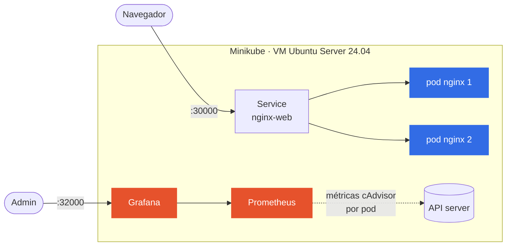
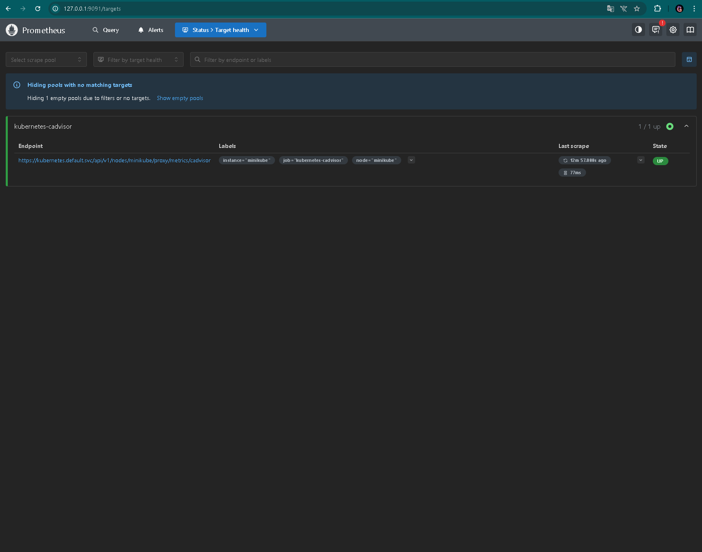
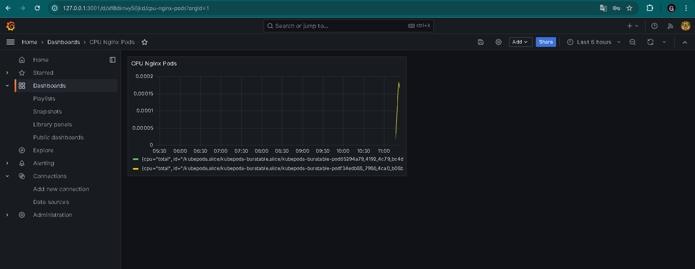
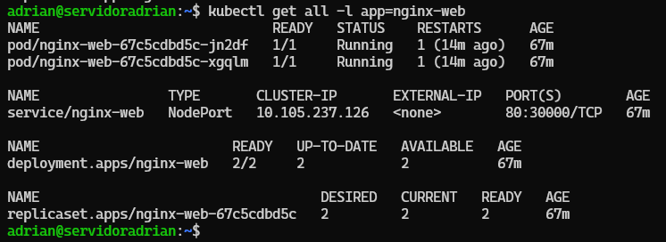
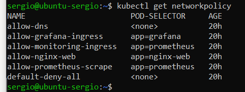

<div align="center">

# ☸️ Kubernetes que se cura solo

**Una web que sobrevive a que se le mueran los pods — monitorizada y cerrada con políticas de red de denegación por defecto.**


<sub><a href="README.md">🇬🇧 English</a> · 🇪🇸 Español</sub>



<sub>Repetición de la prueba de autorrecuperación que puedes lanzar tú — <a href="#-pruébalo-en-5-comandos">mira abajo</a>.</sub>

</div>

## 💡 Qué demuestra

- **Alta disponibilidad** — Nginx con 2 réplicas detrás de un Service. Borras una y la otra sigue sirviendo mientras Kubernetes levanta otra.
- **Autorrecuperación** — liveness y readiness probes en el puerto 80: un pod roto se reinicia, y uno nuevo no recibe tráfico hasta que está listo.
- **Red zero-trust** — 6 NetworkPolicies: se deniega todo por defecto y solo se permite el tráfico web, el scraping de Prometheus y el DNS.
- **Observabilidad** — Prometheus lee cAdvisor a través del API server (con su propio RBAC); Grafana grafica CPU y memoria por pod.
- **Todo como código** — el stack entero son YAML en [`manifests/`](manifests/), con requests y limits para que quepa en una VM pequeña.

## 🏗️ Arquitectura



<details>
<summary><b>🔐 Políticas de red</b> — quién puede hablar con quién</summary>
<br>

| Política | Se aplica a | Permite |
|---|---|---|
| `default-deny-all` | todos los pods | nada de entrada ni de salida |
| `allow-nginx-web` | nginx | entrada TCP 80 |
| `allow-monitoring-ingress` | Prometheus | entrada TCP 9090 |
| `allow-grafana-ingress` | Grafana | entrada TCP 3000 |
| `allow-prometheus-scrape` | Prometheus | salida hacia nginx por TCP 80 |
| `allow-dns` | todos los pods | salida DNS por el 53 (TCP/UDP) |

Fuente: [`manifests/network/networkpolicy.yaml`](manifests/network/networkpolicy.yaml)

</details>

## 🚀 Pruébalo en 5 comandos

En cualquier máquina con Docker, Minikube y kubectl:

```bash
minikube start --driver=docker --memory=2048 --cpus=2
kubectl apply -f manifests/app-web/ -f manifests/monitoring/ -f manifests/network/
kubectl get pods -w                                   # espera a que todo esté Running
kubectl delete $(kubectl get pod -l app=nginx-web -o name | head -1)   # mata una réplica
kubectl get pods -l app=nginx-web -w                  # mira cómo se recupera
```

La web en el NodePort `30000`, Grafana en el `32000` (`minikube service nginx-web --url`) y Prometheus con `kubectl port-forward svc/prometheus 9090`.

## 📸 Evidencias

<table>
<tr>
<td width="50%"><br><sub>Prometheus leyendo cAdvisor — target <b>UP</b></sub></td>
<td width="50%"><br><sub>Grafana — CPU por pod de nginx</sub></td>
</tr>
<tr>
<td><br><sub>Deployment con 2/2 réplicas listas</sub></td>
<td><br><sub>Políticas de red aplicadas</sub></td>
</tr>
</table>

## 👥 Equipo

Proyecto intermodular de 2.º de ASIR, curso 2025–2026. Equipo de tres:

| | Rol |
|---|---|
| **Adrián Boza** ([@adrianboza2](https://github.com/adrianboza2)) | Infraestructura y despliegue en Kubernetes |
| Santiago Pérez ([@santiagoperez27](https://github.com/santiagoperez27)) | Monitorización y observabilidad |
| Sergio López ([@SergioLopez2411](https://github.com/SergioLopez2411)) | Seguridad de red y documentación |

## 🧭 Lo siguiente que haría

Autoescalado con `HPA` · volúmenes persistentes para Grafana y Prometheus · Ingress + cert-manager · un job de GitHub Actions que valide los manifiestos con `kubeconform` · pasar a un clúster multinodo (k3s o AKS/EKS).

---

<sub>📄 La documentación completa (problema y solución, instalación paso a paso, solución de problemas, roadmap) está en [`docs/DETALLES.md`](docs/DETALLES.md), y la memoria del proyecto en [`docs/`](docs/). Licencia MIT.</sub>
