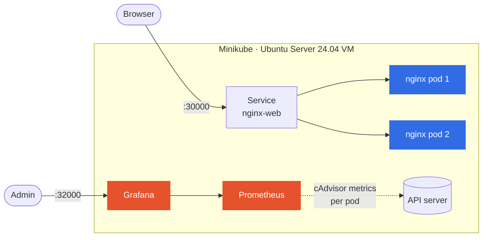
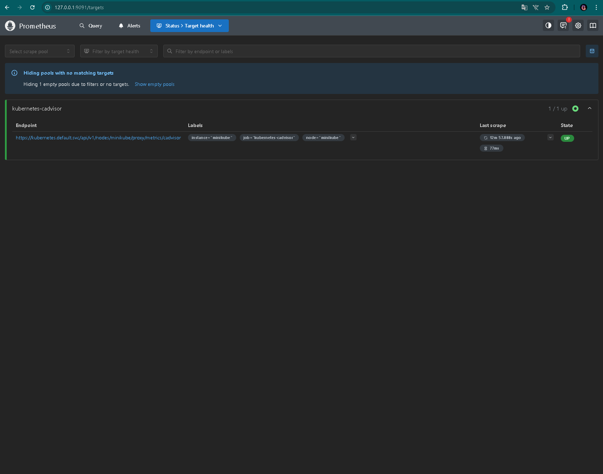
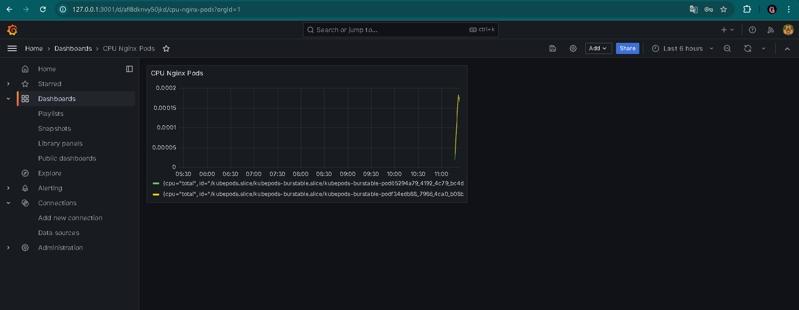
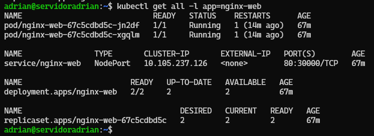
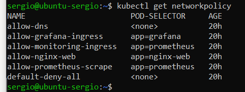

<div align="center">

# ☸️ Self-healing Kubernetes lab

**A web app that survives its own pods dying — monitored, and locked down with default-deny network policies.**


<sub>🇬🇧 English · <a href="README.es.md">🇪🇸 Español</a></sub>



<sub>Replay of the self-healing test you can run yourself — <a href="#-try-it-in-5-commands">see below</a>.</sub>

</div>

## 💡 What it shows

- **High availability** — Nginx runs as 2 replicas behind a Service. Delete one and the other keeps serving while Kubernetes brings a new one up.
- **Self-healing** — liveness and readiness probes on port 80: a broken pod is restarted, and a new one gets no traffic until it is ready.
- **Zero-trust networking** — 6 NetworkPolicies: deny everything by default, then allow only web traffic, Prometheus scraping and DNS.
- **Observability** — Prometheus scrapes cAdvisor through the API server (with its own RBAC); Grafana graphs CPU and memory per pod.
- **Everything as code** — the whole stack is plain YAML in [`manifests/`](manifests/), with resource requests and limits so it fits on a small VM.

## 🏗️ Architecture



<details>
<summary><b>🔐 Network policies</b> — what may talk to what</summary>
<br>

| Policy | Applies to | Allows |
|---|---|---|
| `default-deny-all` | every pod | nothing in, nothing out |
| `allow-nginx-web` | nginx | inbound TCP 80 |
| `allow-monitoring-ingress` | Prometheus | inbound TCP 9090 |
| `allow-grafana-ingress` | Grafana | inbound TCP 3000 |
| `allow-prometheus-scrape` | Prometheus | outbound to nginx on TCP 80 |
| `allow-dns` | every pod | outbound DNS on 53 (TCP/UDP) |

Source: [`manifests/network/networkpolicy.yaml`](manifests/network/networkpolicy.yaml)

</details>

## 🚀 Try it in 5 commands

On any machine with Docker, Minikube and kubectl:

```bash
minikube start --driver=docker --memory=2048 --cpus=2
kubectl apply -f manifests/app-web/ -f manifests/monitoring/ -f manifests/network/
kubectl get pods -w                                   # wait for everything to be Running
kubectl delete $(kubectl get pod -l app=nginx-web -o name | head -1)   # kill one replica
kubectl get pods -l app=nginx-web -w                  # watch it heal
```

Web on NodePort `30000`, Grafana on `32000` (`minikube service nginx-web --url`), Prometheus with `kubectl port-forward svc/prometheus 9090`.

## 📸 Evidence

<table>
<tr>
<td width="50%"><br><sub>Prometheus scraping cAdvisor — target <b>UP</b></sub></td>
<td width="50%"><br><sub>Grafana — CPU per nginx pod</sub></td>
</tr>
<tr>
<td><br><sub>Deployment with 2/2 replicas ready</sub></td>
<td><br><sub>Network policies applied</sub></td>
</tr>
</table>

## 👥 Team

Final project of the Network & Systems Administration degree (ASIR), 2025–2026. Team of three:

| | Role |
|---|---|
| **Adrián Boza** ([@adrianboza2](https://github.com/adrianboza2)) | Kubernetes infrastructure & deployment |
| Santiago Pérez ([@santiagoperez27](https://github.com/santiagoperez27)) | Monitoring & observability |
| Sergio López ([@SergioLopez2411](https://github.com/SergioLopez2411)) | Network security & documentation |

## 🧭 What I'd do next

`HPA` autoscaling · persistent volumes for Grafana/Prometheus · Ingress + cert-manager · a GitHub Actions job that validates the manifests with `kubeconform` · move to a multi-node cluster (k3s or AKS/EKS).

---

<sub>📄 The full write-up (in Spanish: problem/solution, step-by-step install, troubleshooting, roadmap) is in [`docs/DETALLES.md`](docs/DETALLES.md), and the project report in [`docs/`](docs/). MIT licensed.</sub>
